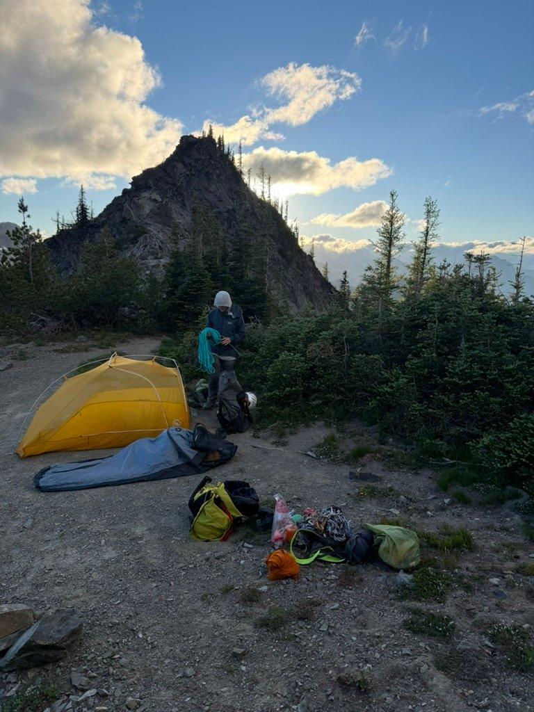
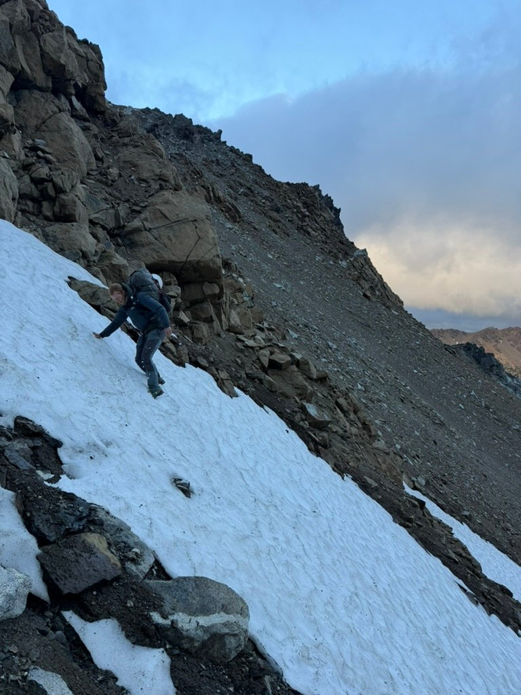
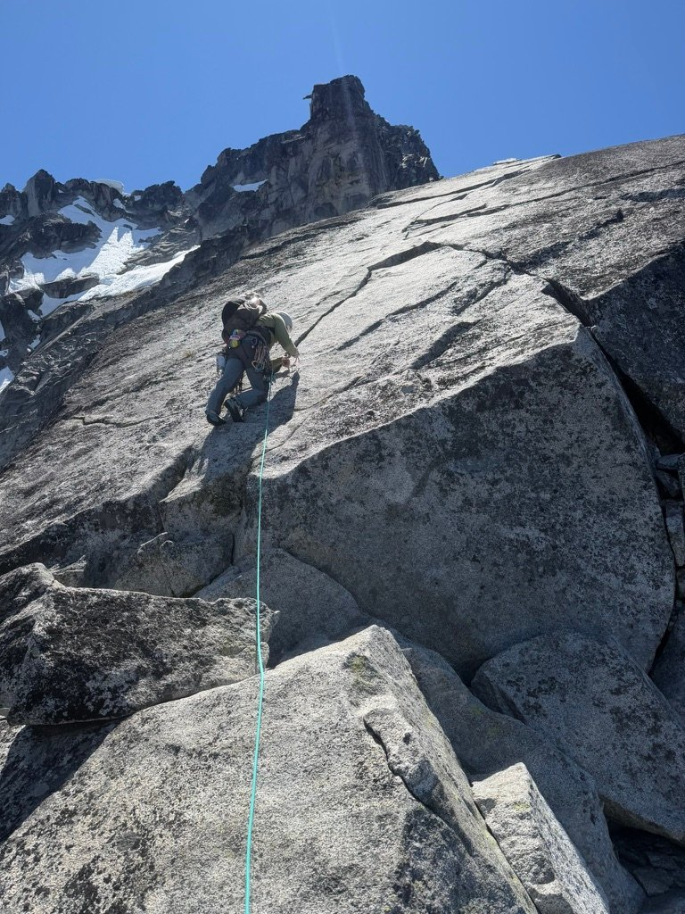

This summer, my friend Cameron and I climbed the Direct North Ridge route on Mt. Stuart. I think it's one of the 50 classic climbs?
Anyways, there's a ton of beta about it online so a few quick thoughts then rad pics:

- do it in a day, we camped and it was a total faff
- make sure you actually stick to the ridge, we were a little casual and had to pitch out some weird stuff to get back on route
- ridge simuling with 50+ foot runouts between pieces feels only marginally safer than soloing for a lot of time wasted

